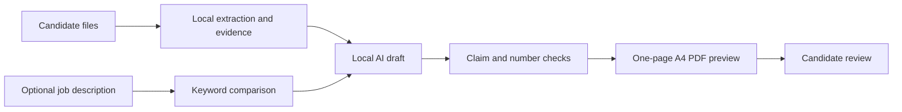
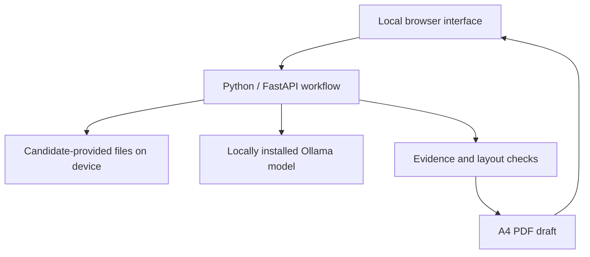

# Gen Resume

### A grounded, local-first resume drafting experience

Gen Resume helps turn a candidate's own documents into a one-page English resume draft. It traces suggested claims back to source evidence, checks numeric statements and page references, and exports an A4 PDF for human review.

**Status:** private local application in development. A public hosted generator, checkout, pricing, and customer sign-ups are **not available yet**. This repository contains the public product overview; the implementation is maintained separately in a private repository.

## How the current local workflow works



### Current local stack (product-level view)



This diagram describes the **private local application**, not code in this public documentation repository. There is no hosted generator, customer database or payment integration.

```text
Candidate documents + optional job description
                  ↓
Page-aware extraction and fact bank
                  ↓
Local model drafts English content
                  ↓
Evidence and numeric checks + review notes
                  ↓
One-page A4 PDF draft → human approval
```

The local application accepts PDF, DOCX, text, and selected project files. The job description is optional. It shows cited facts and review notes alongside the PDF preview. The current workflow uses a locally installed Ollama model; candidate documents are processed on the user's machine in this implementation.

## What the checks mean

- A claim must point to candidate-provided evidence; unsupported numbers are flagged or removed.
- A4 page size and minimum readable font bounds are checked by code.
- The optional keyword view compares a draft with a job description. It is **not** a hiring probability or a promise of ATS success.
- Model review can miss mistakes. The candidate must review and approve the final draft before using it.

## Privacy and availability

The current app is local-first and does not require a cloud account. A future hosted commercial service would need separate privacy, security, retention, billing, and support work before launch. No candidate document, generated resume, or implementation source is published in this repository.

For product inquiries or updates, use the [GitHub profile](https://github.com/Dxrksvng). Screenshots and a public demo will be added only after they are made with synthetic data and reviewed for personal information.

## Repository map

- [Product scope and limitations](docs/PRODUCT.md)
- [Privacy and data boundary](docs/PRIVACY.md)

© 2026 Gen Resume. All rights reserved. No open-source license is granted for the private implementation.
